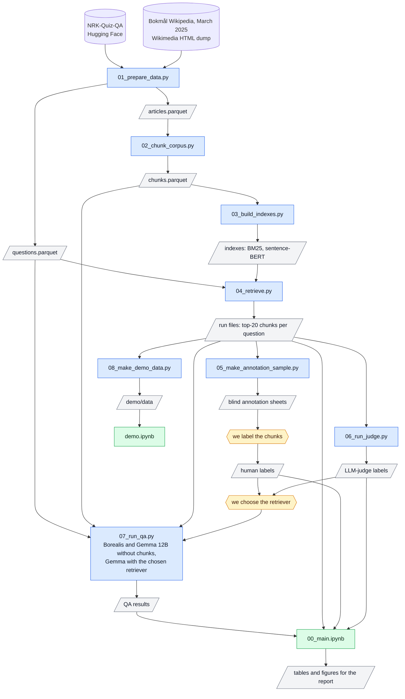

# BBAN4040-spraakteknologi
Course project in the course BBAN4040 Språkteknologi at NTNU Handelshøyskolen.

We compare fine-tuning and retrieval as two ways of making a language model better at questions about Norwegian history and culture (the Bokmål part of NRK-Quiz-QA): Borealis 12B (Gemma 3 fine-tuned on Norwegian instructions) without retrieval against Gemma 3 12B with retrieval over Bokmål Wikipedia (RAG). Gemma 3 12B without retrieval is included as a reference.

## Project structure

```
├── README.md                    This file: overview, setup and how to run everything
├── pyproject.toml               Package metadata and dependencies
├── .env.example                 Template for API keys (copy to .env, never commit .env)
├── configs/
│   └── experiment.yaml          Central experiment settings read by scripts and notebooks
├── src/norrag/                  Reusable code, imported by scripts and notebooks
│   ├── config.py                Settings, paths and secrets
│   ├── records.py               JSONL logging of runs with model, prompt and settings
│   ├── data/                    Loaders for NRK-Quiz-QA and Norwegian Wikipedia
│   ├── chunking.py              Wikipedia articles → chunks with stable chunk_ids
│   ├── retrieval/               BM25 and dense retrievers, query building
│   ├── prompts.py               Prompt templates with and without context
│   ├── models.py                Loading Gemma 3 and Borealis locally
│   ├── scoring.py               Log-likelihood multiple-choice scoring
│   ├── pipeline.py              Runs one condition end to end
│   ├── annotation.py            Evaluation layer 1: blind human annotation sheets
│   ├── judge.py                 Evaluation layer 2: LLM judge
│   └── metrics.py               Accuracy, hit@k, MRR@k, confidence intervals, McNemar, kappa, error breakdown
├── scripts/                     Long-running pipeline steps, run in order 01 → 08
├── notebooks/
│   ├── 00_main.ipynb            MAIN NOTEBOOK: all results in the report
│   ├── 01_data-exploration.ipynb
│   └── 02_error-analysis.ipynb
├── demo/                        Reproduction demo and its small committed data subset
├── data/                        Downloaded and processed data (git-ignored)
├── annotations/                 Human relevance labels and guidelines (committed)
├── results/                     raw/ logs (git-ignored), tables/ and figures/ (committed)
├── tests/                       Unit tests (pytest)
└── docs/                        Architecture guide, decision log, AI-use log and Git cheatsheet
```

## How the pipeline fits together

Blue boxes are scripts you run, grey shapes are files they write, green boxes are notebooks and the hexagon is manual work. Each script reads what the earlier ones wrote, so they run in order and can be rerun one at a time. [docs/architecture.md](docs/architecture.md) explains every step, what each file does and the order to build them in.



## Setup

```bash
python3.12 -m venv .venv
source .venv/bin/activate
pip install -e ".[dev]"
cp .env.example .env   # then fill in the keys
```

## Running the pipeline

TODO

## Reproduction demo

TODO

## Data and licences

- NRK-Quiz-QA v2.0 ([ltg/nrk_quiz_qa](https://huggingface.co/datasets/ltg/nrk_quiz_qa)), Bokmål questions only, MIT licence.
- Norwegian Wikipedia (Bokmål) as of 20 March 2025, from the [Wikimedia Enterprise HTML dumps](https://dumps.wikimedia.org/other/enterprise_html/), CC BY-SA 3.0. See [data/README.md](data/README.md) for why this dump and how the pages are turned into text.
