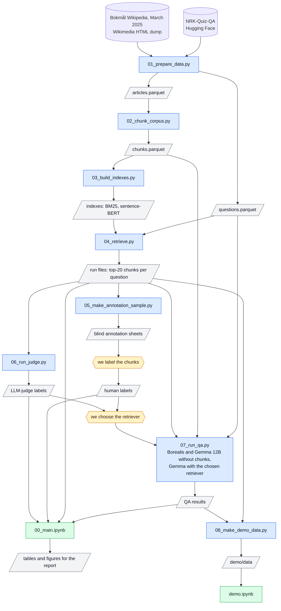

# BBAN4040-spraakteknologi
Course project in the course BBAN4040 Språkteknologi at NTNU Handelshøyskolen.

We compare fine-tuning and retrieval as two ways of making a language model better at questions about Norwegian history and culture (the Bokmål part of NRK-Quiz-QA): Borealis 12B (Gemma 3 fine-tuned on Norwegian instructions) without retrieval against Gemma 3 12B with retrieval over Bokmål Wikipedia (RAG). Gemma 3 12B without retrieval is included as a reference.

## Project structure

```
├── README.md                    This file: overview, setup and how to run everything
├── pyproject.toml               Package metadata and dependencies
├── .env.example                 Template for API keys (copy to .env, never commit .env)
├── configs/
│   └── experiment.yaml          Central experiment settings read by scripts and notebooks
├── src/norrag/                  Reusable code, imported by scripts and notebooks
│   ├── config.py                Settings, paths and secrets
│   ├── records.py               JSONL logging of runs with model, prompt and settings
│   ├── data/                    Loaders for NRK-Quiz-QA and Norwegian Wikipedia
│   ├── chunking.py              Wikipedia articles → chunks with stable chunk_ids
│   ├── retrieval/               BM25 and dense retrievers, query building
│   ├── prompts.py               Prompt templates with and without context
│   ├── models.py                Loading Gemma 3 and Borealis locally
│   ├── scoring.py               Log-likelihood multiple-choice scoring
│   ├── pipeline.py              Runs one condition end to end
│   ├── annotation.py            Evaluation layer 1: blind human annotation sheets
│   ├── judge.py                 Evaluation layer 2: LLM judge
│   └── metrics.py               Accuracy, hit@k, MRR@k, confidence intervals, McNemar, kappa, error breakdown
├── scripts/                     Long-running pipeline steps, run in order 01 → 08
├── notebooks/
│   ├── 00_main.ipynb            MAIN NOTEBOOK: all results in the report
│   ├── 01_data-exploration.ipynb
│   └── 02_error-analysis.ipynb
├── demo/                        Reproduction demo and its small committed data subset
├── data/                        Downloaded and processed data (git-ignored)
├── annotations/                 Human relevance labels and guidelines (committed)
├── results/                     raw/ logs (git-ignored, except the judge's labels), tables/ and figures/ (committed)
└── docs/                        Architecture guide, decision log, AI-use log and Git cheatsheet
```

## How the pipeline fits together

Blue boxes are scripts you run, grey shapes are files they write, green boxes are notebooks and the hexagon is manual work. Each script reads what the earlier ones wrote, so they run in order and can be rerun one at a time. [docs/architecture.md](docs/architecture.md) explains every step, what each file does and the order to build them in.



## Setup

```bash
python3.12 -m venv .venv
source .venv/bin/activate      # Windows: .venv\Scripts\activate
pip install -e .               # the exact package versions are pinned in pyproject.toml
cp .env.example .env           # then fill in the keys you need (see the comments in the file)
```

## Running the pipeline

The scripts run in order, each reading what the earlier ones wrote; every setting is in `configs/experiment.yaml`. Times are from a MacBook Pro M1 Max (64 GB). The slow scripts take `--limit N` for a quick test on a few rows, and the QA and judge scripts skip what is already saved, so a stopped run continues where it left off.

| Step | Command | What it does | Time |
|---|---|---|---|
| 1 | `python scripts/01_prepare_data.py` | Downloads NRK-Quiz-QA and the Wikipedia dump (6.2 GB) and turns them into `questions.parquet` and `articles.parquet` | download + about an hour |
| 2 | `python scripts/02_chunk_corpus.py` | Cuts the articles into 100-word chunks (2.5 million) | a few minutes |
| 3 | `python scripts/03_build_indexes.py` | Builds the BM25 and sentence-BERT indexes | BM25 minutes, sentence-BERT about 4 hours |
| 4 | `python scripts/04_retrieve.py` | Saves the top 20 chunks per question for each retriever | |
| 5 | `python scripts/05_make_annotation_sample.py` | Makes the blind annotation sheets (50 questions); we then label them by hand, see `annotations/README.md` | seconds |
| 6 | `python scripts/06_run_judge.py --sample`, then `--batch` | The LLM judge on the hand-labelled chunks, then on every pooled chunk (needs `ANTHROPIC_API_KEY`; about $29 in total) | 11 minutes, then under 24 hours |
| 7 | `python scripts/07_run_qa.py --model <model> --condition <condition>` | Scores every question; run it for `borealis-12b no_rag`, `gemma-12b no_rag` and `gemma-12b rag_bm25` (needs `HF_TOKEN`) | about 45 minutes without retrieval, about 6 hours with |
| 8 | `python scripts/08_make_demo_data.py` | Copies the small data subset for the demo into `demo/data/` | seconds |

Then run `notebooks/00_main.ipynb` from top to bottom: it reads the saved results, chooses the retriever by the rule in `docs/decisions.md` and writes every table and figure in the report to `results/tables/` and `results/figures/`. `notebooks/02_error-analysis.ipynb` shows example questions for the discussion.

## Reproduction demo

`demo/demo.ipynb` runs the central method end to end on a small committed subset: it builds a BM25 index over about 7,000 Wikipedia chunks, retrieves the top 5 for 100 quiz questions, and scores the answer options with Gemma 3 270M (without and with the chunks) and Borealis 270M (without), using the same code as the full experiment. It then shows the results next to the 12B models' answers to the same questions. It needs none of the scripts or the full data.

1. Set up the environment as above.
2. Create a Hugging Face account, accept the Gemma licence on [huggingface.co/google/gemma-3-270m-it](https://huggingface.co/google/gemma-3-270m-it), create a token and put it in `.env` as `HF_TOKEN=...`.
3. Open `demo/demo.ipynb` and run all cells.

The first run downloads the two 270M models (about 1 GB). After that it takes 30 seconds on an Apple Silicon GPU and about 7 minutes on the M1 Max's CPU alone; expect 5–15 minutes on an ordinary laptop without a GPU. The 270M models score near chance: they show that the method runs, while the report's results come from the 12B models.

## Data and licences

- NRK-Quiz-QA v2.0 ([ltg/nrk_quiz_qa](https://huggingface.co/datasets/ltg/nrk_quiz_qa)), Bokmål questions only, MIT licence.
- Norwegian Wikipedia (Bokmål) as of 20 March 2025, from the [Wikimedia Enterprise HTML dumps](https://dumps.wikimedia.org/other/enterprise_html/), CC BY-SA 3.0. See [data/README.md](data/README.md) for why this dump and how the pages are turned into text.
